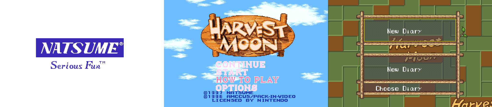
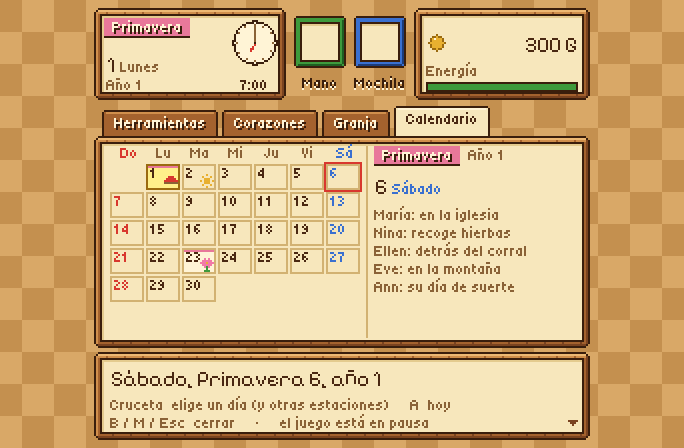
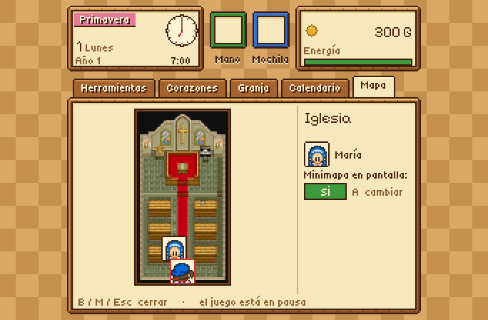
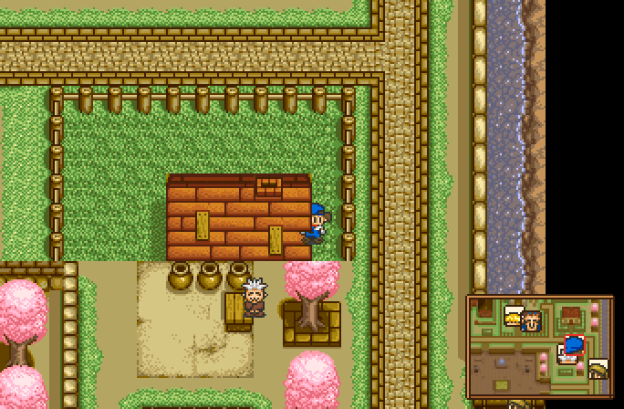

# Harvest Moon SNES Recomp

[English](README.md) · **Español**


Un port nativo para PC de **Harvest Moon** (Super Nintendo, USA) hecho por
*recompilación estática*: el código 65816 del juego se traduce a C y se compila
como un programa de verdad, sobre [snesrecomp](https://github.com/RetroPortingToolKit/snesrecomp).
Además del juego original agrega pantalla ancha, un menú de pausa estilo
Harvest Moon 64, juego infinito después del año 3, trucos, opciones de calidad
de vida y un launcher en varios idiomas.

> [!WARNING]
> **Esto es una beta.** En mis pruebas el juego se puede jugar de principio a
> fin, pero puede haber detalles. Repórtalos en Issues, por favor.

> [!IMPORTANT]
> **Necesitas tu propia copia del juego, obtenida legalmente.** Ni este
> repositorio ni las descargas contienen la ROM ni código traducido de ella.
> Por favor no pidas ROMs.

## Descarga

**[⬇ Descargar la última versión](https://github.com/RodriLoy/HarvestMoonSNESRecomp/releases/latest)**

| Sistema | Archivo |
|---|---|
| Windows 10/11 (x64, y Windows en ARM como Snapdragon) | `harvestmoon-…-windows-x64.zip` |
| Linux x64 | `harvestmoon-…-linux-x64.zip` |

Sin comandos:

1. Descarga el zip de tu sistema y descomprímelo donde quieras.
2. Abre `HarvestMoonSNESRecomp.exe` (Windows) o `HarvestMoonSNESRecomp` (Linux).
3. Elige **tu propia** ROM de *Harvest Moon (USA)* cuando el launcher la pida.
4. El launcher traduce el juego a C y lo compila **en tu computadora** (unos
   minutos, solo la primera vez) y lo abre. Después abre directo al juego.

Por qué funciona así: un ejecutable ya hecho tendría código traducido del
juego, así que no se puede compartir. La descarga es un *paquete de
instalación* —el launcher, el recompilador, este código fuente y herramientas
de compilación portátiles— y el juego se arma con tu copia, en tu máquina. Si
Windows muestra "Windows protegió su PC", elige *Más información → Ejecutar de
todas formas* (el programa no está firmado digitalmente).

## Por qué existe

Soy programador, pero nunca me enfoqué en videojuegos. Harvest Moon es de mis
juegos favoritos de la vida, y al ver que no existía una recompilación de este
juego, gracias a la IA pude trabajar en él.

**Este proyecto se hizo con ayuda de IA.** Yo lo dirigí y estuve supervisando
cada paso: qué hacer, cómo debía comportarse, probarlo en mi propia PC y
decidir qué se queda. Si no te gusta que se haya hecho con ayuda de IA, está
perfecto: simplemente no lo descargues.

## Funciones

### El juego, nativo
- Todo el juego recompilado a C (1.455 funciones), comparado cuadro por cuadro
  con los emuladores bsnes y Snes9x usando los mismos guiones de entrada.
- Pantalla completa, ventana escalable, guardados rápidos, rebobinar y turbo
  (del framework snesrecomp).
- Versiones para **Windows x64**, **Windows en ARM64** (Snapdragon) y **Linux**.
- Sin ventana de consola en Windows.

### Pantalla ancha 16:9 *(activada por defecto)*
Muestra más mapa a los lados en lugar de barras negras, con personajes y
animales dibujados también en los márgenes. El logo de Natsume, la intro, la
pantalla de título y la elección del diario también llenan toda la pantalla. Al llegar al
borde de un mapa y en cuartos pequeños vuelve al 4:3 original, porque ahí el
juego no tiene nada que dibujar. Con la opción apagada la imagen es idéntica
al original, píxel por píxel.




### Menú de pausa estilo Harvest Moon 64 *(tecla M o clic del stick derecho)*
Un menú de pausa a pantalla completa dibujado a la resolución del SNES, así que
sus píxeles son del mismo tamaño que los del juego:
- **Fecha y reloj** — estación, día, año, un reloj con manecillas *y* la hora en
  número, dinero y energía.
- **Herramientas** — casillas de mano y mochila, y la bodega en cuadrícula;
  equipar, cambiar y guardar con las mismas reglas que la bodega del juego.
- **Corazones** — la cara de cada chica (su propio sprite, leído de tu ROM) con
  diez corazones cuyo color sube con el cariño.
- **Granja** — envíos, madera, forraje, vacas, felicidad, abrazos al perro y el
  clima de mañana.
- **Calendario** — la estación como un mes: hoy, el clima de mañana, los seis
  festivales y a dónde van las chicas el fin de semana (de las listas del propio
  juego y de las pistas de los aldeanos). Pasa del 1 o del 30 para ver otras
  estaciones.
- **Mapa** — el lugar completo donde estás (granja, pueblo, montaña o un
  cuarto), dibujado con el mapa que el propio juego tiene en memoria y con los
  colores de la hora. Cada persona aparece con **su propia cara** (sacada de su
  sprite en tu ROM) y las chicas con su nombre. Desde aquí también prendes el
  **minimapa**.
- **La música sigue sonando** con el menú abierto.

| Herramientas | Corazones |
|---|---|
|  |  |
| **Menú en español** | **Calendario** |
|  |  |
| **Mapa** | **Minimapa mientras juegas** |
|  |  |

### Minimapa *(apagado por defecto; menú de pausa → Mapa → A)*
Un mapa pequeño abajo a la derecha de la pantalla, centrado en ti, con la cara
de cada persona y animal cercano (los cuartos se ven al doble de tamaño). Se esconde solo durante los textos,
escenas y transiciones, y tu elección se recuerda (`hm_options.ini`). Apagado,
la imagen es exactamente la original.

### Juego infinito *(activado por defecto)*
El original termina el 30 de verano del año 3. Ahora ves el final completo y
luego despiertas esa misma mañana y sigues con tu granja en el año 4, 5 y más.
El diario muestra "4th", "5th"… correctamente.

### OPTIONS en la pantalla de título
Una cuarta opción debajo de HOW TO PLAY que abre el menú de opciones.


### Trucos *(apagados por defecto)*
Dinero infinito · energía infinita · detener el reloj · madera y forraje
infinitos · semillas y alimento infinitos · controlar el clima. Solo actúan con
una partida cargada y nunca ponen valores que el juego no pueda tener, así que
tu partida sigue válida si los apagas.

### Calidad de vida
Texto rápido (4×) · días más largos (1.5× a 4×) · opciones dentro del juego
(Esc o Select+L3 abre el launcher sobre el juego).

### Launcher
Con aspecto de Harvest Moon (dibujo original, colores de granja e ícono propio),
en **inglés, español o italiano** (inglés por defecto; la elección se guarda y
también cambia la página de Mods y el menú de pausa). Puedes poner tu propia
portada guardándola como `assets/img/portada.png` (o `.jpg`) junto al juego.

| Launcher | Página de Mods |
|---|---|
|  |  |

## Controles (teclado, se cambian en el launcher)

| Tecla | SNES / acción |
|---|---|
| Flechas | Cruceta |
| X / Z / S / A | A / B / X / Y |
| C / V | L / R |
| Enter / Shift derecho | Start / Select |
| M (o R3) | Menú de pausa |
| Esc (o Select+L3) | Opciones (launcher sobre el juego) |
| P | Pausa simple |
| Alt+Enter | Pantalla completa |
| Shift+F1…F10 / F1…F10 | Guardado / carga rápida |
| F12 (mantener) | Rebobinar |
| Tab (mantener) | Turbo |

Los controles de Xbox, PlayStation y Switch Pro se detectan solos.

## Compilar desde el código

Solo hace falta si quieres modificar el código; para jugar basta la descarga
de arriba. Necesitas: Git, Python 3, Rust (stable), CMake, Ninja y un compilador de C/C++
(GCC o Clang), además de **tu propia ROM** de *Harvest Moon (USA)*:

| | |
|---|---|
| SHA-256 | `73a3aa87ddd5ce5df5ba51292316f42b6e128280179b0a1b11b4dcddc17d4163` |
| CRC32 | `f829129e` |
| MD5 | `c9bf36a816b6d54aed79d43a6c45111a` |

```sh
git clone https://github.com/RodriLoy/HarvestMoonSNESRecomp.git
cd HarvestMoonSNESRecomp
bash tools/apply_patches.sh                      # framework y launcher en sus versiones fijadas, más los parches de este port
RUSTUP_TOOLCHAIN=stable bash tools/regen.sh --rom /ruta/a/tu/rom.sfc   # genera src/gen desde TU ROM
cmake -S . -B build -G Ninja -DCMAKE_BUILD_TYPE=Release
cmake --build build
./build/HarvestMoonSNESRecomp
```

Para Windows desde Linux:
- x64: `-DCMAKE_TOOLCHAIN_FILE=cmake/mingw-w64-x86_64.cmake` (MinGW-w64)
- ARM64: `-DCMAKE_TOOLCHAIN_FILE=cmake/zig-windows-arm64.cmake` (Zig, `pip install ziglang`)

`tools/regen.sh` rechaza cualquier ROM que no coincida con las huellas de
arriba. El C generado (`src/gen/`) sale del juego, así que nunca se sube al
repositorio: `.gitignore` lo bloquea, igual que cualquier ROM o partida guardada.

## Estructura

| Ruta | Qué hay |
|---|---|
| `src/hm_*.c` | Este port: menú de pausa, pantalla ancha, juego infinito, trucos, calidad de vida, OPTIONS, traducciones, aspecto del launcher |
| `mods/preloaded/packages/` | Los paquetes de trucos y calidad de vida de la página de Mods |
| `tools/` | Paso de ROM a C, ajustes a la generación, generadores de fuentes, íconos y dibujo |
| `framework_patches/`, `recomp_ui_patches/` | Los cambios de este port a snesrecomp y recomp-ui |
| `recomp/` | Configuración del recompilador y perfiles de cobertura (solo direcciones, sin datos del juego) |
| `ESTADO.md` | Notas detalladas del desarrollo |

## Estado

**Beta.** Límites conocidos:
- El juego infinito se probó forzando la fecha al último día; todavía no se ha
  hecho una partida completa de tres años.
- Solo se admite la versión USA del juego.

## Créditos

Este port se apoya en el trabajo de otras personas; gracias a todas.

- **[HM-Decomp](https://github.com/ElisaS-Codes/HM-Decomp)** de **ElisaS-Codes**
  y **DasK** — el desensamblado de Harvest Moon que empezaron en 2023. De sus
  etiquetas, mapa de RAM y notas sale lo que este port entiende del juego: los
  nombres de la RAM, las reglas de la bodega, la comprobación del final que usa
  el juego infinito, los festivales y los corazones del menú de pausa.
- **[snesrecomp](https://github.com/RetroPortingToolKit/snesrecomp)**
  (RetroPortingToolKit / Matthew Stanley) — el recompilador estático, runtime,
  host de escritorio, paquetes de instalación y plantilla de versiones sobre
  los que está hecho este port.
- **[recomp-ui](https://github.com/mstan/recomp-ui)** (Matthew Stanley) — el
  launcher.
- **[SDL3](https://libsdl.org)**, **[Dear ImGui](https://github.com/ocornut/imgui)**
  — ventana, controles, audio y la interfaz del launcher.
- **[Pixelify Sans](https://github.com/eifetx/Pixelify-Sans)** y
  **[Tiny5](https://github.com/Gissio/font_tiny5)** (SIL OFL) — las fuentes
  pixel del menú de pausa; fuentes **[DejaVu](https://dejavu-fonts.github.io)**.
- **[bsnes](https://github.com/bsnes-emu/bsnes)** y
  **[Snes9x](https://github.com/snes9xgit/snes9x)** — emuladores de referencia
  para verificar la recompilación cuadro por cuadro (no se distribuyen).
- **[Zig](https://ziglang.org)** y **[MinGW-w64](https://www.mingw-w64.org)**
  — las versiones para Windows ARM64 y x64.
- **Harvest Moon** © 1996 Pack-In-Video / AMCCUS, © 1997 Natsume. Todos los
  nombres, personajes y gráficos pertenecen a sus dueños; este es un proyecto
  de fan sin fines de lucro, no afiliado ni respaldado por ellos.

Todos los detalles, incluido el arte original hecho para este port, están en
[CREDITS.md](CREDITS.md).

## Licencia

El código propio de este repositorio está bajo la licencia
[PolyForm Noncommercial 1.0.0](LICENSE); no cubre ninguna parte del juego.

---

**Lo que sigue:** también estoy trabajando en una **descompilación** del juego
—reescribir sus rutinas como C legible, verificado contra el original— como un
proyecto aparte.
