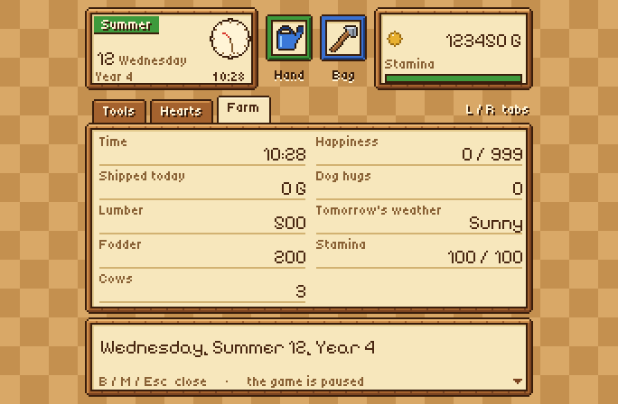

# Harvest Moon SNES Recomp

**English** · [Español](README.es.md)


A native PC port of **Harvest Moon** (Super Nintendo, USA) made by *static
recompilation*: the game's 65816 code is translated to C and compiled into a
real program, built on [snesrecomp](https://github.com/RetroPortingToolKit/snesrecomp).
On top of the original game it adds widescreen, a Harvest Moon 64-style pause
menu, an endless game past Year 3, cheats, quality-of-life options and a
multi-language launcher.

> [!WARNING]
> **This is a beta.** It plays the game from start to finish in my tests, but
> expect rough edges. Please report what you find in the Issues.

> [!IMPORTANT]
> **You need your own, legally obtained copy of the game.** This repository
> contains **no ROM and no game data**, and no pre-built executables are
> distributed (they would contain code translated from the game). You build
> the port yourself from your own cartridge dump. Please do not ask for ROMs.

## Why this exists

I'm a programmer, but I never focused on video games. Harvest Moon is one of my
favorite games of my whole life, and when I saw that no recompilation of it
existed, AI made it possible for me to work on it anyway.

**This project was made with the help of AI.** I directed it and supervised
every step: what to build, how it should behave, testing it on my own PC and
deciding what stays. If you don't like that it was made with the help of AI,
that's completely fine — just don't download it.

## Features

### The game, native
- The whole game recompiled to C (1,455 functions), checked frame by frame
  against the bsnes and Snes9x emulators with the same input scripts.
- Fullscreen, a resizable window, save states, rewind and turbo (from the
  snesrecomp framework).
- Builds for **Windows x64**, **Windows on ARM64** (Snapdragon) and **Linux**.
- No console window on Windows.

### Widescreen 16:9 *(on by default)*
Shows more of the map at the sides instead of black bars, with characters and
animals drawn in the margins too. At a map's edge, in small rooms and on the
title screen it falls back to the original 4:3, because there the game has
nothing to draw. With the option off, the picture is identical to the
original, pixel for pixel.


### Harvest Moon 64-style pause menu *(M key or right-stick click)*
A full-screen pause menu drawn at the SNES's own resolution, so its pixels are
the same size as the game's:
- **Date and clock** — season, day, year, an analog clock *and* the time in
  figures, money and stamina.
- **Tools** — hand and backpack slots and the tool shed as a grid; equip, swap
  and put away with the same rules as the game's own tool shed.
- **Hearts** — each bachelorette's face (her own sprite, read from your ROM)
  with ten hearts whose colour rises with her affection.
- **Farm** — shipping, lumber, fodder, cows, happiness, dog hugs, tomorrow's
  weather.
- **The music keeps playing** while the menu is open.

| Tools | Hearts | Farm |
|---|---|---|
|  |  |  |

### Endless game *(on by default)*
The original ends on Summer 30 of Year 3. Now you watch the ending in full,
then wake up that same morning and keep farming through Year 4, 5 and beyond.
The diary shows "4th", "5th"… correctly.

### OPTIONS on the title screen
A fourth entry under HOW TO PLAY that opens the options menu.


### Cheats *(off by default)*
Infinite money · infinite stamina · stop the clock · infinite lumber and
fodder · infinite seeds and feed · control the weather. They only act while a
diary is loaded and never set values the game couldn't have, so your save
stays valid when you turn them off.

### Quality of life
Fast text (4×) · longer days (1.5× to 4×) · in-game options (Esc or
Select+L3 opens the launcher over the running game).

### Launcher
A Harvest Moon look (original artwork, farm colours, its own icon), in
**English, Spanish or Italian** (English by default; the choice is saved and
also changes the Mods page and the pause menu). You can show your own cover
picture by saving it as `assets/img/portada.png` (or `.jpg`) next to the game.

| Launcher | Mods page |
|---|---|
|  |  |

## Controls (keyboard, changeable in the launcher)

| Key | SNES / action |
|---|---|
| Arrows | D-pad |
| X / Z / S / A | A / B / X / Y |
| C / V | L / R |
| Enter / Right Shift | Start / Select |
| M (or R3) | Pause menu |
| Esc (or Select+L3) | Options (launcher over the game) |
| P | Simple pause |
| Alt+Enter | Fullscreen |
| Shift+F1…F10 / F1…F10 | Quick save / load |
| F12 (hold) | Rewind |
| Tab (hold) | Turbo |

Xbox, PlayStation and Switch Pro controllers are detected automatically.

## Building

You need: Git, Python 3, Rust (stable), CMake, Ninja and a C/C++ compiler
(GCC or Clang), plus **your own ROM** of *Harvest Moon (USA)*:

| | |
|---|---|
| SHA-256 | `73a3aa87ddd5ce5df5ba51292316f42b6e128280179b0a1b11b4dcddc17d4163` |
| CRC32 | `f829129e` |
| MD5 | `c9bf36a816b6d54aed79d43a6c45111a` |

```sh
git clone https://github.com/RodriLoy/HarvestMoonSNESRecomp.git
cd HarvestMoonSNESRecomp
bash tools/apply_patches.sh                      # framework + launcher at their pins, plus this port's patches
RUSTUP_TOOLCHAIN=stable bash tools/regen.sh --rom /path/to/your/rom.sfc   # generates src/gen from YOUR ROM
cmake -S . -B build -G Ninja -DCMAKE_BUILD_TYPE=Release
cmake --build build
./build/HarvestMoonSNESRecomp
```

Windows builds from Linux:
- x64: `-DCMAKE_TOOLCHAIN_FILE=cmake/mingw-w64-x86_64.cmake` (MinGW-w64)
- ARM64: `-DCMAKE_TOOLCHAIN_FILE=cmake/zig-windows-arm64.cmake` (Zig, `pip install ziglang`)

`tools/regen.sh` refuses any ROM that doesn't match the hashes above. The
generated C (`src/gen/`) is derived from the game, so it is never committed —
`.gitignore` blocks it, together with every ROM and save file.

## Project layout

| Path | What lives there |
|---|---|
| `src/hm_*.c` | This port: pause menu, widescreen, endless game, cheats, quality of life, title OPTIONS, translations, launcher look |
| `mods/preloaded/packages/` | The cheats and quality-of-life packages shown on the Mods page |
| `tools/` | ROM → C pipeline, generation overrides, font/icon/artwork generators |
| `framework_patches/`, `recomp_ui_patches/` | This port's changes to snesrecomp and recomp-ui |
| `recomp/` | Recompiler configuration and coverage profiles (addresses only, no game data) |
| `ESTADO.md` | Detailed development notes (Spanish) |

## Status

**Beta.** Known limits:
- The endless game was tested by forcing the date to the last day; a full
  three-year playthrough hasn't been done yet.
- Only the USA version of the game is supported.

## Credits and license

See [CREDITS.md](CREDITS.md) for everything this port is built on, and thanks
to everyone behind it. This repository's own code is under the
[PolyForm Noncommercial 1.0.0](LICENSE) license; it covers no part of the game.
*Harvest Moon* belongs to its rights holders; this is a non-commercial fan
project, not affiliated with them.

---

**What's next:** I'm also working on a **decompilation** of the game —
rewriting its routines as readable C, verified against the original — as a
separate project.
