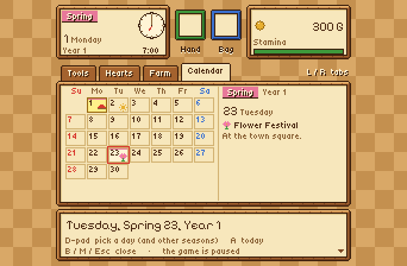

# Harvest Moon SNES Recomp

**English** · [Español](README.es.md)


A native PC port of **Harvest Moon** (Super Nintendo, USA) made by *static
recompilation*: the game's 65816 code is translated to C and compiled into a
real program, built on [snesrecomp](https://github.com/RetroPortingToolKit/snesrecomp).
On top of the original game it adds widescreen, a Harvest Moon 64-style pause
menu, an endless game past Year 3, cheats, quality-of-life options and a
multi-language launcher.

> [!WARNING]
> **This is a beta.** It plays the game from start to finish in my tests, but
> expect rough edges. Please report what you find in the Issues.

> [!IMPORTANT]
> **You need your own, legally obtained copy of the game.** Neither this
> repository nor the downloads contain the ROM or any code translated from it.
> Please do not ask for ROMs.

## Download

**[⬇ Download the latest release](https://github.com/RodriLoy/HarvestMoonSNESRecomp/releases/latest)**

| System | File |
|---|---|
| Windows 10/11 (x64, and Windows on ARM such as Snapdragon) | `harvestmoon-…-windows-x64.zip` |
| Linux x64 | `harvestmoon-…-linux-x64.zip` |

No commands needed:

1. Download the zip for your system and unzip it anywhere.
2. Open `HarvestMoonSNESRecomp.exe` (Windows) or `HarvestMoonSNESRecomp` (Linux).
3. Pick **your own** *Harvest Moon (USA)* ROM when the launcher asks for it.
4. The launcher translates the game to C and builds it **on your computer**
   (a few minutes, only the first time), then starts it. After that it opens
   straight into the game.

Why it works this way: a ready-made executable would contain code translated
from the game, so it can't be shared. The download is a *setup pack* — the
launcher, the recompiler, this source code and portable build tools — and the
game itself is made from your copy, on your machine. If Windows shows
"Windows protected your PC", choose *More info → Run anyway* (the program
isn't digitally signed).

## Why this exists

I'm a programmer, but I never focused on video games. Harvest Moon is one of my
favorite games of my whole life, and when I saw that no recompilation of it
existed, AI made it possible for me to work on it anyway.

**This project was made with the help of AI.** I directed it and supervised
every step: what to build, how it should behave, testing it on my own PC and
deciding what stays. If you don't like that it was made with the help of AI,
that's completely fine — just don't download it.

## Features

### The game, native
- The whole game recompiled to C (1,455 functions), checked frame by frame
  against the bsnes and Snes9x emulators with the same input scripts.
- Fullscreen, a resizable window, save states, rewind and turbo (from the
  snesrecomp framework).
- Builds for **Windows x64**, **Windows on ARM64** (Snapdragon) and **Linux**.
- No console window on Windows.

### Widescreen 16:9 *(on by default)*
Shows more of the map at the sides instead of black bars, with characters and
animals drawn in the margins too. The Natsume logo, the intro, the title screen
and the diary selection fill the whole screen as well. At a map's edge and in small
rooms it falls back to the original 4:3, because there the game has nothing
to draw. With the option off, the picture is identical to the original, pixel
for pixel.


### Harvest Moon 64-style pause menu *(M key or right-stick click)*
A full-screen pause menu drawn at the SNES's own resolution, so its pixels are
the same size as the game's:
- **Date and clock** — season, day, year, an analog clock *and* the time in
  figures, money and stamina.
- **Tools** — hand and backpack slots and the tool shed as a grid; equip, swap
  and put away with the same rules as the game's own tool shed.
- **Hearts** — each bachelorette's face (her own sprite, read from your ROM)
  with ten hearts whose colour rises with her affection.
- **Farm** — shipping, lumber, fodder, cows, happiness, dog hugs, tomorrow's
  weather.
- **Calendar** — the season as a month: today, tomorrow's weather, the six
  festivals and where the girls go at weekends (from the game's own lists and
  the townsfolk's hints). Move past the 1st or the 30th to see other seasons.
- **The music keeps playing** while the menu is open.

| Tools | Hearts |
|---|---|
|  |  |
| **Farm** | **Calendar** |
|  |  |

### Endless game *(on by default)*
The original ends on Summer 30 of Year 3. Now you watch the ending in full,
then wake up that same morning and keep farming through Year 4, 5 and beyond.
The diary shows "4th", "5th"… correctly.

### OPTIONS on the title screen
A fourth entry under HOW TO PLAY that opens the options menu.


### Cheats *(off by default)*
Infinite money · infinite stamina · stop the clock · infinite lumber and
fodder · infinite seeds and feed · control the weather. They only act while a
diary is loaded and never set values the game couldn't have, so your save
stays valid when you turn them off.

### Quality of life
Fast text (4×) · longer days (1.5× to 4×) · in-game options (Esc or
Select+L3 opens the launcher over the running game).

### Launcher
A Harvest Moon look (original artwork, farm colours, its own icon), in
**English, Spanish or Italian** (English by default; the choice is saved and
also changes the Mods page and the pause menu). You can show your own cover
picture by saving it as `assets/img/portada.png` (or `.jpg`) next to the game.

| Launcher | Mods page |
|---|---|
|  |  |

## Controls (keyboard, changeable in the launcher)

| Key | SNES / action |
|---|---|
| Arrows | D-pad |
| X / Z / S / A | A / B / X / Y |
| C / V | L / R |
| Enter / Right Shift | Start / Select |
| M (or R3) | Pause menu |
| Esc (or Select+L3) | Options (launcher over the game) |
| P | Simple pause |
| Alt+Enter | Fullscreen |
| Shift+F1…F10 / F1…F10 | Quick save / load |
| F12 (hold) | Rewind |
| Tab (hold) | Turbo |

Xbox, PlayStation and Switch Pro controllers are detected automatically.

## Building from source

Only needed if you want to change the code; players can use the download
above. You need: Git, Python 3, Rust (stable), CMake, Ninja and a C/C++ compiler
(GCC or Clang), plus **your own ROM** of *Harvest Moon (USA)*:

| | |
|---|---|
| SHA-256 | `73a3aa87ddd5ce5df5ba51292316f42b6e128280179b0a1b11b4dcddc17d4163` |
| CRC32 | `f829129e` |
| MD5 | `c9bf36a816b6d54aed79d43a6c45111a` |

```sh
git clone https://github.com/RodriLoy/HarvestMoonSNESRecomp.git
cd HarvestMoonSNESRecomp
bash tools/apply_patches.sh                      # framework + launcher at their pins, plus this port's patches
RUSTUP_TOOLCHAIN=stable bash tools/regen.sh --rom /path/to/your/rom.sfc   # generates src/gen from YOUR ROM
cmake -S . -B build -G Ninja -DCMAKE_BUILD_TYPE=Release
cmake --build build
./build/HarvestMoonSNESRecomp
```

Windows builds from Linux:
- x64: `-DCMAKE_TOOLCHAIN_FILE=cmake/mingw-w64-x86_64.cmake` (MinGW-w64)
- ARM64: `-DCMAKE_TOOLCHAIN_FILE=cmake/zig-windows-arm64.cmake` (Zig, `pip install ziglang`)

`tools/regen.sh` refuses any ROM that doesn't match the hashes above. The
generated C (`src/gen/`) is derived from the game, so it is never committed —
`.gitignore` blocks it, together with every ROM and save file.

## Project layout

| Path | What lives there |
|---|---|
| `src/hm_*.c` | This port: pause menu, widescreen, endless game, cheats, quality of life, title OPTIONS, translations, launcher look |
| `mods/preloaded/packages/` | The cheats and quality-of-life packages shown on the Mods page |
| `tools/` | ROM → C pipeline, generation overrides, font/icon/artwork generators |
| `framework_patches/`, `recomp_ui_patches/` | This port's changes to snesrecomp and recomp-ui |
| `recomp/` | Recompiler configuration and coverage profiles (addresses only, no game data) |
| `ESTADO.md` | Detailed development notes (Spanish) |

## Status

**Beta.** Known limits:
- The endless game was tested by forcing the date to the last day; a full
  three-year playthrough hasn't been done yet.
- Only the USA version of the game is supported.

## Credits

This port stands on other people's work — thank you to all of them.

- **[HM-Decomp](https://github.com/ElisaS-Codes/HM-Decomp)** by **ElisaS-Codes**
  and **DasK** — the disassembly of Harvest Moon they started in 2023. Its
  labels, RAM map and notes are where this port's understanding of the game
  comes from: the RAM names, the tool shed rules, the ending check behind the
  endless game, the festivals and the hearts used by the pause menu.
- **[snesrecomp](https://github.com/RetroPortingToolKit/snesrecomp)**
  (RetroPortingToolKit / Matthew Stanley) — the static recompiler, runtime,
  desktop host, setup packs and release template this port is built on.
- **[recomp-ui](https://github.com/mstan/recomp-ui)** (Matthew Stanley) — the
  launcher.
- **[SDL3](https://libsdl.org)**, **[Dear ImGui](https://github.com/ocornut/imgui)**
  — window, input, audio and the launcher UI.
- **[Pixelify Sans](https://github.com/eifetx/Pixelify-Sans)** and
  **[Tiny5](https://github.com/Gissio/font_tiny5)** (SIL OFL) — the pause
  menu's pixel fonts; **[DejaVu](https://dejavu-fonts.github.io)** fonts.
- **[bsnes](https://github.com/bsnes-emu/bsnes)** and
  **[Snes9x](https://github.com/snes9xgit/snes9x)** — reference emulators used
  to check the recompilation frame by frame (not distributed).
- **[Zig](https://ziglang.org)** and **[MinGW-w64](https://www.mingw-w64.org)**
  — the Windows ARM64 and x64 builds.
- **Harvest Moon** © 1996 Pack-In-Video / AMCCUS, © 1997 Natsume. All names,
  characters and graphics belong to their owners; this is a non-commercial fan
  project, not affiliated with or endorsed by them.

Full details, including the original artwork made for this port, are in
[CREDITS.md](CREDITS.md).

## License

This repository's own code is under the [PolyForm Noncommercial 1.0.0](LICENSE)
license; it covers no part of the game.

---

**What's next:** I'm also working on a **decompilation** of the game —
rewriting its routines as readable C, verified against the original — as a
separate project.
